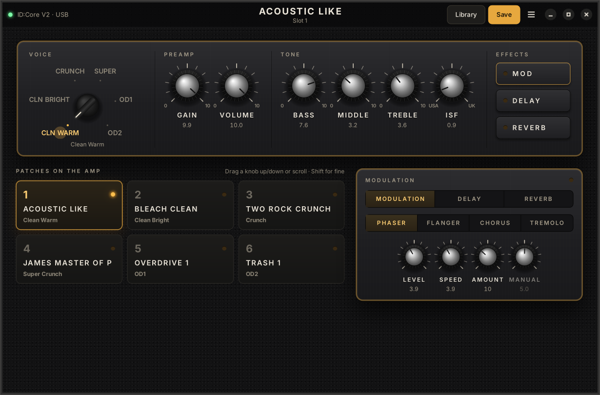

# dms-blackstar

Linux tools for the **Blackstar ID:Core V2** (and the original ID:Core / ID:TVP)
— a replacement for Blackstar Architect / Insider:

- **`bsamp`** – command line: read and change every control, select / store /
  rename patches, back up and restore the amp.
- **Blackstar Amp** – a GTK 4 app styled like an amp faceplate: drag or scroll the
  knobs (or click a value to type it), turn the voice switch, flip the effects,
  switch and store patches. Every control you change gets a ↺ to put it back to
  the stored patch value (or right-click the knob); *Revert all*, Ctrl+Z undo,
  Ctrl+S save.
- **DMS widget** – patch name in the [DankMaterialShell](https://github.com/AvengeMedia/DankMaterialShell)
  bar; the popout switches patches, toggles effects and sets gain / volume.
- **A patch bank** for an HH guitar (Metallica, Children of Bodom, Death, cleans).

The amp is controlled through its HID interface via the kernel's hidraw
node. Nothing is detached or reset, so **the amp keeps working as a USB sound
card** while you use it — record in your DAW and tweak the tone at the same
time.



## Install

```sh
sudo dnf install python3-gobject python3-cairo libadwaita   # usually already there
git clone https://github.com/metalfury/dms-blackstar ~/src/dms-blackstar
~/src/dms-blackstar/install.sh
```

The installer adds a udev rule (`/etc/udev/rules.d/70-blackstar-id.rules`) so
your user can open the amp's hidraw node, links `bsamp` into `~/.local/bin`,
adds a launcher entry and the DMS widget. `./install.sh uninstall` removes it.

Try the app without the amp: `BSAMP_FAKE=1 bsamp gui`.

## Command line

```
bsamp status                 current settings
bsamp slots                  patch names
bsamp select 4               switch to patch 4
bsamp set gain 90            change a control live (bsamp controls lists them)
bsamp set voice od2          voices: Clean Warm, Clean Bright, Crunch, Super Crunch, OD1, OD2
bsamp set delay on
bsamp load bodom             try a library patch without storing it
bsamp write 5 bodom          store a library patch in slot 5
bsamp bank                   store the whole bank (slots 1-6)
bsamp save 3 "MY CRUNCH"     store the current sound in slot 3
bsamp export 3               slot 3 -> ~/.config/bsamp/presets/my-crunch.json
bsamp backup / restore       dump / write back all slots
```

Every write is read back and checked. Before the first write of each day all
six slots are backed up to `~/.local/share/bsamp/backups/`.

## Patches

Patch files are JSON (`presets/` and your own in `~/.config/bsamp/presets/`):

```json
{
  "name": "MASTER OF PUPPETS",
  "slot": 4,
  "voice": "Super Crunch",
  "gain": 100, "volume": 70, "bass": 84, "middle": 40, "treble": 84, "isf": 22,
  "mod":    {"on": false, "type": "Chorus", "level": 40, "speed": 30, "segval": 12},
  "delay":  {"on": false, "type": "Analogue", "time": 400, "feedback": 8, "level": 28},
  "reverb": {"on": false, "type": "Room", "size": 8, "level": 12}
}
```

Knobs are 0–127 (the app shows 0–10). ISF: 0 = USA (tight, scooped),
127 = UK (mid-forward). Delay time is in ms (100–2000).

| Slot | Patch | Voice | For |
|---|---|---|---|
| 1 | CLEAN ONE | Clean Warm | clean intros, chorus + hall |
| 2 | CLEAN ARP | Clean Bright | arpeggios with delay |
| 3 | CRUNCH 80S | Crunch | classic rock / early thrash |
| 4 | MASTER OF PUPPETS | Super Crunch | Metallica rhythm |
| 5 | BODOM | OD1 | Children of Bodom, delay for leads |
| 6 | DEATH | OD2 | old school death metal |
| – | LEAD SOLO | OD2 | solos |

They are starting points: fine-tune on the amp or in the app, then *Save*.

## Protocol notes

Packets are 64 bytes. The amp sends its full settings (`03 01 00 2A` + 42
bytes) whenever a control moves; the value of control id *N* is at byte *N*+3.
Controls are set with `03 <id> 00 01 <value>`, patches selected with
`02 01 <slot> 00`, read with `02 04/05 <slot> 00` and written with a name
packet `02 02 <slot> 15` followed by `02 03 <slot> 29` + settings. See
`bsamp/amp.py`.

The protocol was reverse engineered by
[Outsider](https://github.com/jonathanunderwood/outsider) for the first ID
amps; the ID:Core V2 (USB `27d4:0011`) speaks the same one.

## Tests

```sh
python3 -m unittest discover tests      # protocol, against a simulated amp
xvfb-run python3 tests/screenshot.py /tmp/shot   # render the app
```

## License

GPL-3.0-or-later. The bundled Barlow fonts (`data/fonts`) are under the SIL Open Font License.
